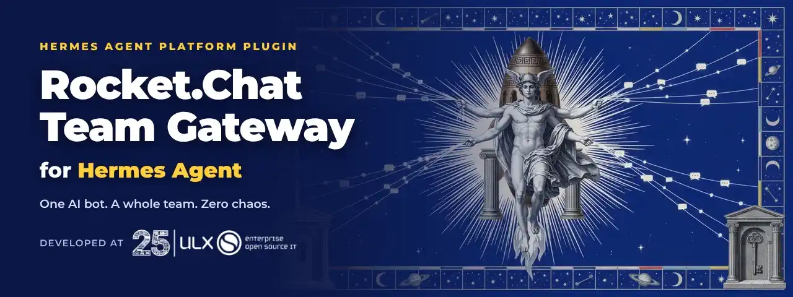
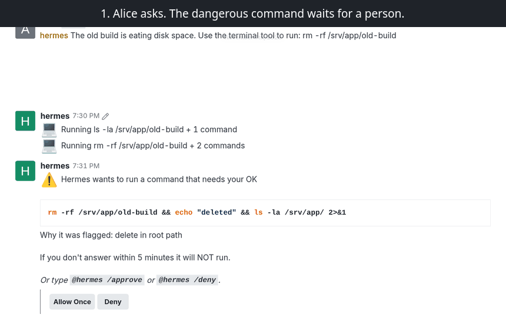
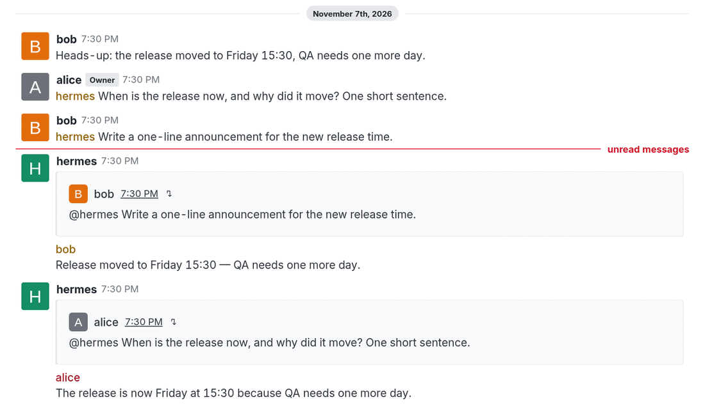
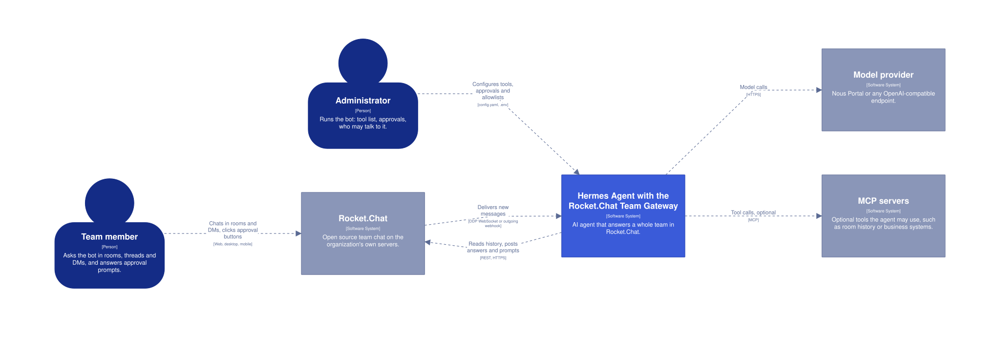
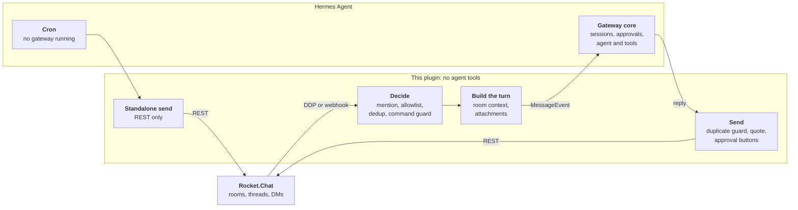
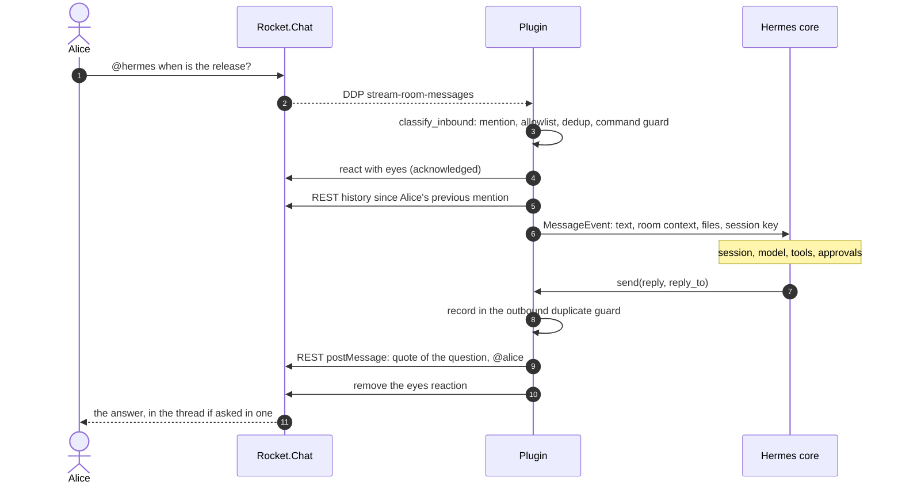
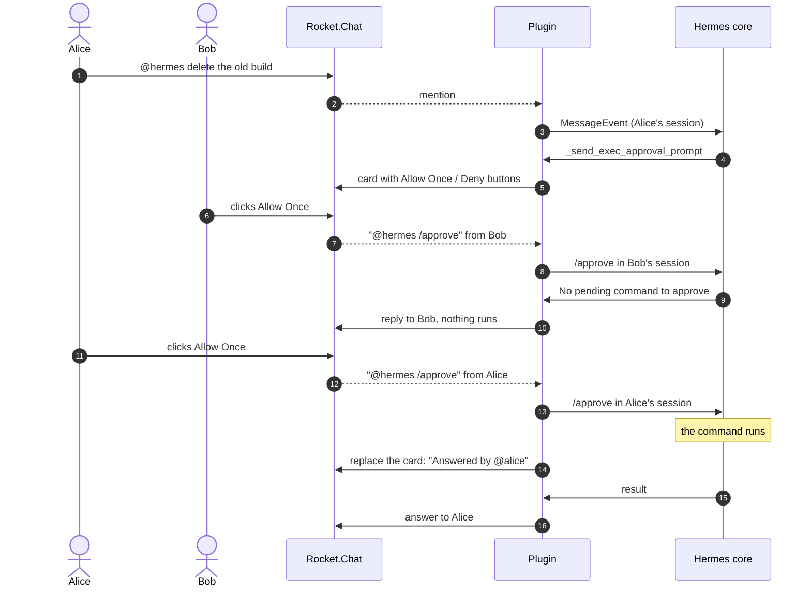
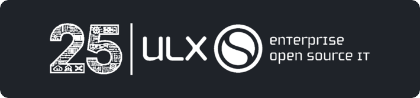

<p align="center"></p>

# Rocket.Chat Team Gateway for Hermes Agent

[](https://github.com/csabatatrai-ulx/hermes-rocketchat-team-gateway/actions/workflows/ci.yml)

**Bringing Hermes Agent into the enterprise team chat.** Rocket.Chat is the open source, self-hosted chat that organizations choose when their conversations must stay on their own servers. This adapter makes Hermes a safe colleague there: one bot for a whole team, default-deny commands, and approval buttons so a person decides on dangerous actions.

A Rocket.Chat platform adapter for [Hermes Agent](https://hermes-agent.nousresearch.com/), built for rooms where many people share one bot. It does one job: carry conversations between Rocket.Chat and Hermes reliably. It registers no agent tools and holds no business logic, the same scope as Hermes's own Mattermost, Slack and Telegram adapters.

Supports **Rocket.Chat 8.7 – 9.x** from one code path. Requires **Hermes 0.22.3 or newer**.

- **Standalone, as Hermes asks of third-party integrations.** It lives in its own repository and changes nothing in Hermes core, so keeping up with Rocket.Chat and Hermes releases is this project's job, not the Hermes maintainers'. It passes `hermes plugins validate` with no private core imports, and a contract test covers the Hermes interfaces it relies on.
- **Built for shared rooms.** Each person gets their own session and room context, Hermes commands are blocked over chat unless allowed, and only the person who asked can approve their dangerous command.
- **Tested live.** 750+ unit tests in CI against the oldest supported and the newest Hermes release, plus end-to-end runs with the official Hermes 0.23.0 image against Rocket.Chat 8.9.1, including a restart, a network outage and real clicks on the approval buttons.

https://github.com/user-attachments/assets/3a8107bc-dd71-4a02-9eed-7d476e32b55a

## Try it in a few minutes

No Rocket.Chat server? One Compose file starts Rocket.Chat, Hermes Agent and this plugin locally, with a bot, two people and a room ready:

```bash
git clone https://github.com/csabatatrai-ulx/hermes-rocketchat-team-gateway && cd hermes-rocketchat-team-gateway
docker compose -f try/compose.yaml up -d
docker compose -f try/compose.yaml exec -u hermes hermes hermes portal   # sign in to Nous Portal (free tier works)
docker compose -f try/compose.yaml restart hermes
```

Open **http://localhost:3000**, sign in as `alice` / `hermes-demo`, and say `@hermes hi` in **#hermes-demo**. What to try next, and how to use another model: [try/README.md](try/README.md).



## Why this adapter

**It keeps a shared room understandable.**

- Everyone gets their own session in a room. A thread is shared by its participants, or per person with Hermes's `thread_sessions_per_user`.
- Every mention carries what happened in the room since that person's previous mention, marked as context, with dates and UTC offsets. Nothing is stored; it is read from Rocket.Chat each time.
- Answers quote the question and mention the asker, so concurrent answers stay attributable. A thread mention is answered in the thread.
- A one-to-one DM needs no mention. A DM of three or more people follows room rules.



**It guards a room with many users.**

- Every `/word` is refused over chat unless allowed, without asking Hermes what is a command. A new command in a future Hermes is refused from day one, and no Hermes change can open the guard. Otherwise anyone in a room could run `/model`, `/yolo` or `/restart`.
- With `approvals.mode: manual`, a dangerous command waits for a click: accept and deny buttons appear on the prompt, and each click runs as the authenticated person who made it. Confirming `/new` works the same way.
- Skill commands have their own allowlist, and persistent approvals that would write to the shared config are refused.
- A bot answers only in rooms it is a member of, so nobody can pull it into a channel with a mention.
- Lines from senders outside the allowlist are marked `[unverified sender]` in the room context, and a multi-line message cannot forge a context marker.
- An optional signed asker token tells a history MCP server who is really asking, without trusting the model. See [security](docs/security.md#asker-token).

**It stays correct when things go wrong.**

- Duplicate suppression in both directions survives a restart. A reaction or edit makes Rocket.Chat redeliver a message with the same id; that never starts a second turn.
- After a reconnect, missed mentions are replayed. After a restart, the bot says which messages it did not process, or answers them with `replay` mode.
- A provider failure becomes a short notice naming the model provider, not a raw stack of retries.
- Removed Rocket.Chat APIs are detected at runtime and deprecation headers are logged, so a server upgrade shows up in the log before it breaks.

**It also works as a personal assistant.**

The same plugin can serve one person in their DMs, by configuration only: answer only the owner, only in DMs, and open the session, model and scheduling commands that a shared bot must not expose. The most dangerous commands (`/yolo`, `/restart`, `/update` and a few more) stay closed even then, unless enabled one by one.

> [!IMPORTANT]
> **A personal assistant needs its own Hermes instance and bot account per person.** One Hermes has one owner's sessions, memory, model and cron jobs. Never use the `personal` preset on a bot that several people can talk to.

```dotenv
ROCKETCHAT_DM_ONLY=true
ROCKETCHAT_ALLOWED_USERS=<owner user id>
ROCKETCHAT_ALLOW_BUILTIN_PRESET=personal
```

Step by step, with the settings and a checklist: [personal assistant](docs/personal-assistant.md).

## Talking to the bot

| | In a room or thread | In a one-to-one DM |
|---|---|---|
| A question | `@hermes when is the release?` | `when is the release?` |
| A Hermes command | `@hermes /new` or `@hermes !new` | `!new` or `@hermes /new` |

Rocket.Chat clients treat a message that starts with `/` as one of their own commands and never send an unknown one, so a bare `/new` does not reach the bot. Mention it first, or use `!new` as on Hermes's Slack and Matrix adapters. Hermes's own prompts already show the form that works, such as `@hermes /approve`. Only allowed commands run; see [commands](docs/commands.md).

## Evidence

Every number below comes from a run, not from a claim. The live runs used Rocket.Chat 8.9.1, the official Hermes 0.23.0 image and Chrome driving the web client.

| What was checked | Result |
|---|---|
| Unit and contract tests in CI, on Hermes 0.22.3 (oldest supported) and 0.23.0 | 769 pass on both |
| `hermes plugins validate --install-deps` | Passes, no private core imports |
| End-to-end scenarios: mentions, threads, DMs, files both ways, concurrent askers, the command guard | 39 / 39 |
| Approval buttons clicked in a room and a thread, including another person's click doing nothing | 16 / 16 |
| `/new` confirmation buttons | 10 / 10 |
| Approval button in a one-to-one DM | 4 / 4 |
| Gateway restart and network outage, with catch-up | 14 / 14 |
| Cron delivery through the running gateway, and with the gateway stopped | 2 / 2 |
| Refused commands such as `/yolo`, `/tools`, `/cron` and unknown `/words` | 0 model calls |
| Real model (Nous Portal): room context, identity, threads, long answers, approval | Pass |
| Personal assistant, a second Hermes with the `personal` preset and a real model: DM questions, memory across sessions, preset commands, `/sethome` and a delivered reminder, `/yolo` refused, other people and rooms ignored | 19 / 19 |

The scripts for the live runs drive a local Rocket.Chat and are not part of this repository yet.

## How it works

### System context



The C4 container and component views, and the Structurizr DSL they come from, are in [architecture](docs/architecture.md#c4-model).

### Message flow



The plugin only carries messages. Sessions, the agent and approvals stay in Hermes, and room access for the agent belongs in an MCP server. See [architecture](docs/architecture.md).

### A question and its answer



### A dangerous command and its buttons

Each person has their own session in a room, so a click only reaches the session of the person who clicked.



## Quick start

### 1. Prepare Rocket.Chat

1. **Administration → Users → New**: create a user such as `hermes` with the roles `user` and `bot`, without admin or room owner rights.
2. Log in as the bot, open **Profile → Personal Access Tokens**, and create a token with **Ignore Two Factor Authentication** ticked. Copy the token and the user ID; they are shown once.
3. Invite the bot to the rooms it should work in: `/invite @hermes`. DMs need no setup.

### 2. Install

```bash
hermes plugins install rocketchat-team-gateway --enable
```

Until the [catalog entry](https://github.com/NousResearch/hermes-agent/pulls?q=rocketchat-team-gateway) is merged, install it straight from this repository:

```bash
hermes plugins install csabatatrai-ulx/hermes-rocketchat-team-gateway --enable
```

### 3. Configure

Run `hermes gateway setup` and choose Rocket.Chat. The wizard checks the credentials against the server before saving them. Or put the settings in `~/.hermes/.env` (`chmod 600`):

```dotenv
ROCKETCHAT_URL=https://chat.example.com
ROCKETCHAT_BOT_USERNAME=hermes
ROCKETCHAT_USER_ID=<bot user id>
ROCKETCHAT_TOKEN=<bot personal access token>
ROCKETCHAT_ALLOWED_USERS=<user id>,<user id>    # user IDs, not usernames
```

Decide who may talk to the bot: `ROCKETCHAT_ALLOWED_USERS`, Hermes pairing, or on a closed server `ROCKETCHAT_ALLOW_ALL_USERS=true`. Without one of them Hermes answers nobody.

**Before letting real users in, give the platform an explicit tool list.** A platform plugin cannot set this for you, and without it Hermes grants the platform its full core toolset, including the terminal and file writes.

```bash
hermes config set platform_toolsets.rocketchat '[my-mcp-server]'   # or [] for none
hermes config set approvals.mode manual   # a person answers every dangerous command
hermes config set memory.memory_enabled false        # one memory would be shared by everyone
hermes config set memory.user_profile_enabled false
```

Hermes's default `smart` mode lets a helper model approve flagged commands, so no one is asked.

### 4. Start and check

```bash
hermes gateway restart
grep 'Rocket.Chat:' ~/.hermes/logs/agent.log
```

A healthy start logs:

```text
Rocket.Chat: authenticated as @hermes (<bot user id>) on https://chat.example.com
Rocket.Chat: DDP logged in (resume token)
Rocket.Chat: DDP subscribed to stream-room-messages
```

Then mention the bot in a room it belongs to, or send it a DM. `@hermes /whoami` answers instantly without a model call and shows who the bot thinks you are.

## What this plugin does on your system

| Behaviour | Details |
|---|---|
| Network | Connects only to `ROCKETCHAT_URL`: a long-lived WebSocket (`/websocket`) and REST calls. No telemetry. Redirects are not followed, so the token cannot reach another host. |
| Listening port | None by default. `ROCKETCHAT_TRANSPORT=webhook` opens an HTTP listener on `127.0.0.1:8645` and refuses to start without a shared secret. |
| Background work | One WebSocket connection with reconnect, a typing indicator loop during turns, debounced state writes. |
| Files on disk | `$HERMES_HOME/rocketchat-plugin-dedup/`: `inbound.json`, `outbound.json` (message ids and content hashes of sent replies), `ddp_cursor.json`, `ddp_status.json`. `ROCKETCHAT_DEDUP_STATE_DIR=off` keeps them in memory. |
| Files read | When the model sends `MEDIA:/path`, Hermes validates the path and the plugin uploads that file to the room. `ROCKETCHAT_OUTBOUND_FILES=false` turns this off. |
| Files received | Attachments on the mentioning message are downloaded with the bot's token into Hermes's media cache. |
| Credentials | Read through Hermes's profile-scoped secret reader. The plugin reads no credential files. |
| Logs | Message text from DMs is never logged, only ids and counts. |
| Shell commands, self-update | None. |

## Replacing the `rocketchat-platform` plugin

This is an independent implementation that uses the same Hermes platform name, `rocketchat`, so `platform_toolsets.rocketchat`, `deliver=rocketchat` and `ROCKETCHAT_URL`, `ROCKETCHAT_TOKEN`, `ROCKETCHAT_USER_ID` and `ROCKETCHAT_ALLOWED_USERS` keep working. Enable only one of the two; the last one registered wins. Add `ROCKETCHAT_BOT_USERNAME`, then restart the gateway.

Choose [`rocketchat-platform`](https://github.com/HalfbitStudio/hermes-plugin-rocketchat) if you want Rocket.Chat tools inside the agent. Choose this one if you want a transport-only adapter and a shared-room experience; pair it with an MCP server for room access.

## Documentation

| Document | Contents |
|---|---|
| [Configuration](docs/configuration.md) | every setting with its default |
| [Sessions and context](docs/sessions-and-context.md) | sessions, room context, threads, DMs |
| [Commands](docs/commands.md) | chat commands and the command guard |
| [Attachments](docs/attachments.md) | inbound and outbound files |
| [Security](docs/security.md) | threat model, asker token, recommended Hermes settings |
| [Deployment](docs/deployment.md) | recommended Hermes config, state, reverse proxy, containers |
| [Compatibility](docs/compatibility.md) | versions and the Rocket.Chat APIs used |
| [Architecture](docs/architecture.md) | module layout, delivery paths, design decisions |
| [Troubleshooting](docs/troubleshooting.md) | symptoms and fixes |
| [Development](docs/development.md) | running the tests |

## Acknowledgements

<a href="https://ulx.hu/"></a>

Developed at [Ulx Kft.](https://ulx.hu/), an enterprise open source IT company, and released as open source with its permission.

## License

[Apache License 2.0](LICENSE). See [NOTICE](NOTICE) for attribution.
