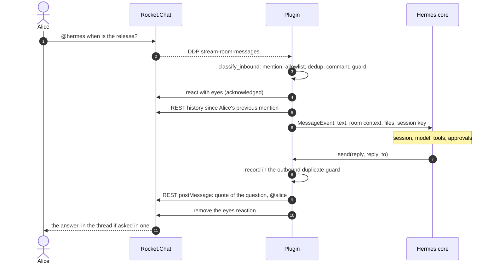
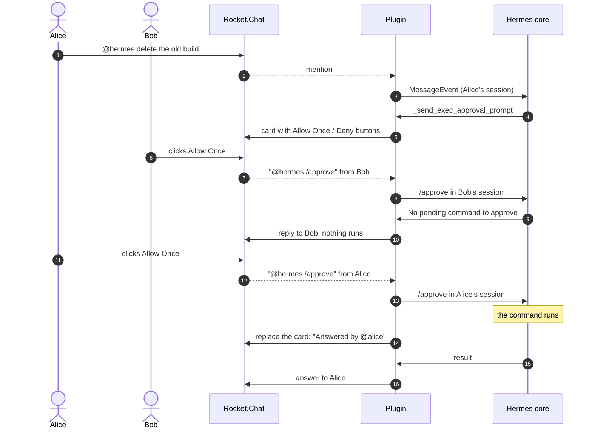
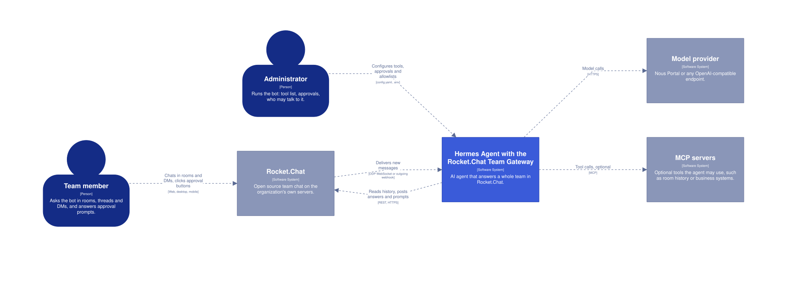
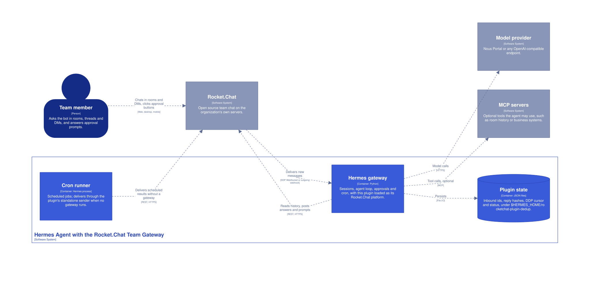
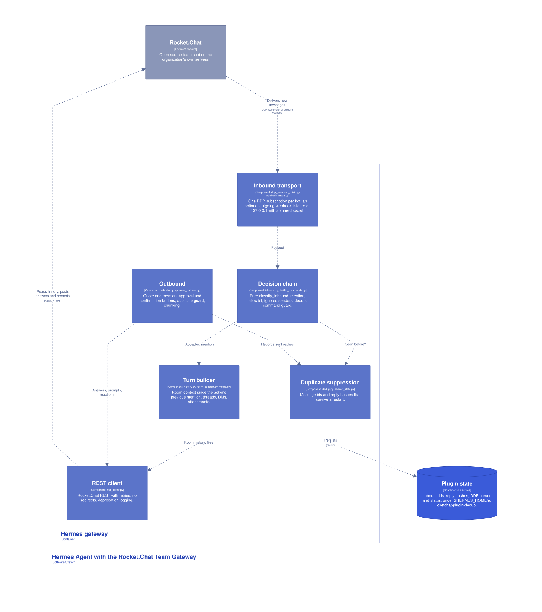

# Architecture

## Scope

This plugin is the wire between Hermes and Rocket.Chat, and nothing else. In Rocket.Chat the agent still uses every tool Hermes gives it (terminal, files, web, code, MCP servers), chosen per platform with `platform_toolsets.rocketchat`; the plugin only adds none of its own. Registering no tools is a design decision that matches Hermes's own messaging adapters, none of which registers agent tools. Hermes's platform guide also says plugins "must not register an equivalent model surface that lets the agent initiate outbound messages on its own". Capabilities such as searching a room belong to tools the agent reaches over MCP, where they work from every channel and can be permissioned separately.

To give the agent Rocket.Chat capabilities too (search a room, read its history, post elsewhere), connect an MCP server. Rocket.Chat 8.8 and later ships a native one (Enterprise plans with the AI add-on; alpha), and community servers exist:

```bash
hermes mcp add rocketchat --url https://chat.example.com/api/v1/mcp   # authentication: see Rocket.Chat's MCP documentation
hermes config set platform_toolsets.rocketchat '[terminal, rocketchat]'   # the tools this bot may use
```

With the optional [signed asker token](security.md#asker-token), such a server knows who is really asking.

## Message flow

Two inbound paths, one decision function, one outbound path. Both inbound paths build the same payload shape and end in the same pure `classify_inbound`, so their behaviour cannot drift apart.

<figure class="diagram narrow" markdown>



</figure>

Cron delivery without a running gateway takes a separate, REST-only path: `standalone_send`, which Hermes calls from its own process.

### A question and its answer

What happens between a mention and the answer, on the default DDP path.



### A dangerous command and its buttons

With `approvals.mode: manual`. Each person has their own session in a room, so a click only reaches the session of the person who clicked.



The buttons send exactly what a person could type, so the allowlist, the command guard, Hermes's admin lists and the session key apply to a click unchanged. There is no separate authorization path to get wrong.

## C4 model

The model is kept as [Structurizr DSL](https://github.com/csabatatrai-ulx/hermes-rocketchat-team-gateway/blob/main/docs/diagrams/c4/workspace.dsl), so the three views below come from one source.

### System context

Who uses it and what it talks to. The conversation stays on the organization's own Rocket.Chat; only model and tool calls leave it, to the providers the administrator chooses.

<figure class="c4" markdown>

[](images/c4-context.svg)

<figcaption>Click to open full size.</figcaption>

</figure>

### Containers

What runs and what it writes. The plugin lives inside the Hermes gateway process; its only files are the duplicate-suppression state.

<figure class="c4" markdown>

[](images/c4-containers.svg)

<figcaption>Click to open full size.</figcaption>

</figure>

### Components

The plugin's parts inside the gateway, and the modules that implement them.

<figure class="c4" markdown>

[](images/c4-components.svg)

<figcaption>Click to open full size.</figcaption>

</figure>

## Modules

| Module | Responsibility | Depends on Hermes |
|---|---|---|
| `adapter.py` | `BasePlatformAdapter` implementation, `register()` | Yes |
| `ddp_transport_mixin.py` | Realtime API connection, reconnect, catch-up | Yes |
| `webhook_mixin.py` | Webhook listener, shared dispatch, building the turn | Yes |
| `scoped_env.py` | Profile-scoped environment | Yes |
| `setup_wizard.py` | `hermes gateway setup` | Yes |
| `standalone.py` | Delivery from cron without a live adapter | Yes |
| `inbound.py` | The decision chain, pure | No |
| `builtin_commands.py` | Command guard | No |
| `history.py`, `room_session.py`, `dm_session.py` | Context windows and boundaries | No |
| `media.py` | Attachment handling | No |
| `dedup.py`, `shared_state.py` | Duplicate suppression, process-wide state | No |
| `rest_client.py` | REST API | No |
| `config.py` | All settings in one dataclass | No |
| `prompt_guidance.py`, `user_texts.py` | Text for the model, text for users | No |
| `approval_buttons.py`, `reply_reference.py`, `rc_markdown.py`, `reasoning_format.py`, `asker.py`, `whoami.py` | Small pure helpers | No |

`tests/test_agnostic_boundary.py` fails the build if a Hermes-independent module imports Hermes.

## Decisions worth knowing

- **The order of checks in `classify_inbound` matters.** The dedup runs after the mention and allowlist filters, so room chatter cannot push an old mention out of the cache, and before any command or turn, so a redelivery runs nothing again.
- **One DDP subscription, not one per room.** Rocket.Chat limits subscriptions per connection, and a per-room design failed at about 40 rooms. Messages from non-member rooms are dropped.
- **Sessions are Hermes's.** The plugin passes the real thread and chat type and keeps no session logic.
- **Context stays in `channel_context`,** never in `text`, so command recognition keeps working.
- **State is process-wide.** Hermes can create a short-lived second adapter instance for a concurrent send; per-instance caches and locks would not protect against that case.
- **Outbound dedup records before sending.** If the POST fails after the server created the message, a retry must not post it twice. An explicit refusal removes the record, so a retry really sends.
- **POST retries live in the REST client,** because Hermes core does not retry its primary response delivery.
- **No signal handlers.** `disconnect()` is the documented shutdown hook; `signal.signal` would replace core's handler.
