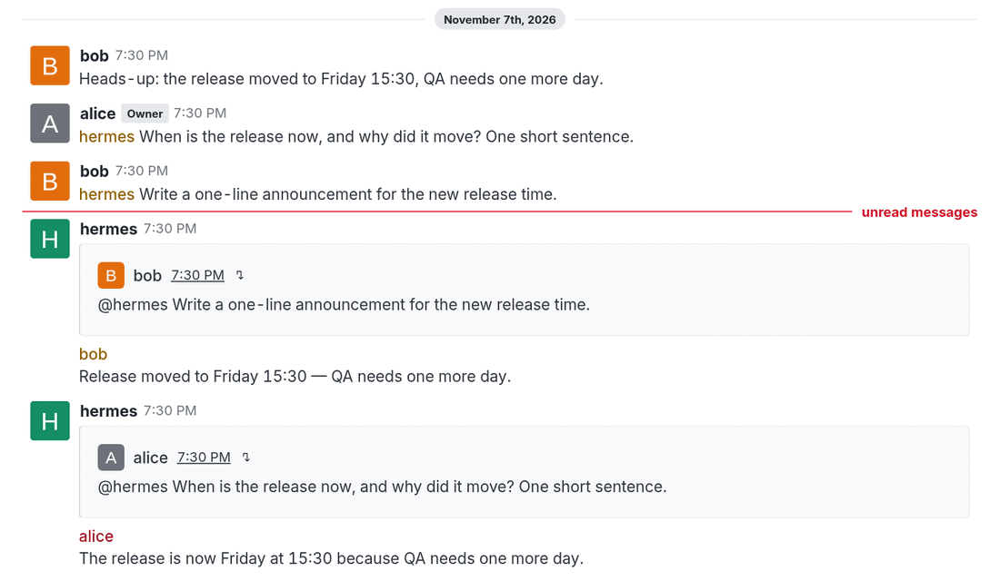
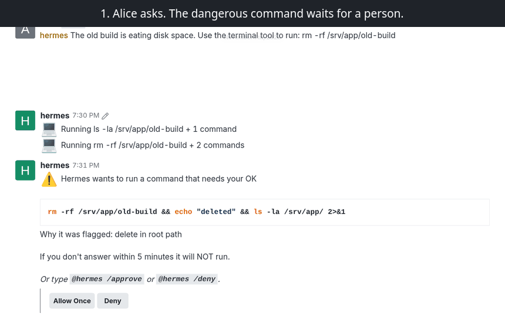

<video class="hero-bg" muted loop playsinline preload="none" poster="images/hero-poster.jpg" aria-hidden="true" tabindex="-1">
  <source data-src="images/hero-loop.webm" type="video/webm">
  <source data-src="images/hero-loop.mp4" type="video/mp4">
</video>

Hermes Agent platform plugin

# Bringing Hermes Agent into the enterprise team chat

Rocket.Chat is the open source, self-hosted chat that organizations choose when their conversations must stay on their own servers. This adapter makes Hermes a safe colleague there: one bot for a whole team, default-deny commands, and approval buttons so a person decides on dangerous actions.

[Try it locally](try.md){ .md-button .md-button--primary }
[Install on your server](getting-started.md){ .md-button }
[Watch the demo](#demo){ .md-button }

Two people, one bot, the same moment: each answer quotes its question and mentions its asker.

  
<strong>750+</strong>tests in CI on two Hermes releases

  
<strong>0</strong>private Hermes imports

  
<strong>8.7 – 9.x</strong>Rocket.Chat versions, one code path

  
<strong>0.22.3+</strong>Hermes Agent versions

## See it working { #demo }

  <video controls preload="metadata" playsinline poster="images/demo-poster.jpg">
    <source src="videos/demo.mp4" type="video/mp4">
    <a href="https://github.com/csabatatrai-ulx/hermes-rocketchat-team-gateway#readme">Watch the demo on GitHub</a>
  </video>

An 89-second real run: a real Rocket.Chat, the real gateway and a real model. Nothing is staged.

### ChatOps: a fix that waits for a human

  <video controls preload="metadata" playsinline poster="images/ops-poster.jpg">
    <source src="videos/chatops-demo.mp4" type="video/mp4">
    <a href="https://github.com/csabatatrai-ulx/hermes-rocketchat-team-gateway#readme">Watch the ChatOps clip on GitHub</a>
  </video>

A simulated outage in a sandbox: the service, its logs and the alert are staged; what Hermes does, the commands it runs and the approvals are not.

## Why teams use it

-   :material-account-group-outline:{ .lg .middle } **Built for shared rooms**

    ---

    Everyone gets their own session and room context. Answers quote the question and mention the asker, so concurrent conversations stay attributable.

    [:octicons-arrow-right-24: Sessions and context](sessions-and-context.md)

-   :material-shield-check-outline:{ .lg .middle } **Safe in front of many users**

    ---

    Every `/word` is refused unless allowed, without asking Hermes what a command is. Dangerous actions wait for the person who asked to click. A message cannot attach the bot's files with `@file:`.

    [:octicons-arrow-right-24: Commands and approvals](commands.md)

-   :material-restart:{ .lg .middle } **Correct when things go wrong**

    ---

    Duplicate suppression survives a restart. Missed mentions are replayed after a reconnect; after a restart the bot says what it missed, or answers it.

    [:octicons-arrow-right-24: Deployment](deployment.md)

-   :material-transit-connection-variant:{ .lg .middle } **Transport only**

    ---

    No agent tools, no business logic, no Hermes internals. Room access for the agent belongs in an MCP server, where it can be permissioned separately.

    [:octicons-arrow-right-24: Architecture](architecture.md)

## How it works

<figure class="diagram" markdown>

</figure>

The lighter boxes are the plugin. It only carries messages: sessions, the agent and approvals stay in Hermes. Cron delivery without a running gateway and the module layout are in [Architecture](architecture.md).

## A person decides on dangerous actions

Bob clicks Allow Once on Alice's request and nothing runs. Alice clicks, and the prompt records who answered.

## Talking to the bot

| | In a room or thread | In a one-to-one DM |
|---|---|---|
| A question | `@hermes when is the release?` | `when is the release?` |
| A Hermes command | `@hermes /new` or `@hermes !new` | `!new` or `@hermes /new` |

Rocket.Chat clients never send an unknown `/command`, so mention the bot first or use `!new`, as on Hermes's Slack and Matrix adapters. Hermes's own prompts already show the form that works.

-   **Try it in a few minutes**

    ---

    One Compose file starts Rocket.Chat, Hermes Agent and this plugin, with a bot, two people and a room ready. No account or API key needed.

    [:octicons-arrow-right-24: Try it locally](try.md)

-   **Run it for your team**

    ---

    A dedicated bot account, a personal access token, an explicit tool list and manual approvals.

    [:octicons-arrow-right-24: Install on your server](getting-started.md)

-   **Or as a personal assistant**

    ---

    One owner, DMs only, with sessions, model switching and scheduling open. Each person needs their own Hermes instance and bot account.

    [:octicons-arrow-right-24: Set up a personal assistant](personal-assistant.md)

---

Developed at [ULX](https://ulx.hu/), an enterprise open source IT company. Licensed under Apache-2.0.
